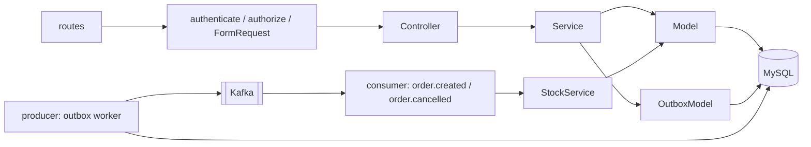

# marketplace-catalog

Serviço de catálogo do [marketplace](https://github.com/DeborahDalonso/marketplace):
produtos, categorias, visualizações e reserva de estoque. É o dono do estoque,
então é ele quem responde à saga do pedido com `stock.reserved` ou
`stock.rejected`.

## Stack

- Node 22, ESM, Express 4
- MySQL 8 via `mysql2`, migrations numeradas rodadas no boot
- Kafka (Redpanda) via `kafkajs`, padrão Outbox no produtor e tabela
  `processed_events` no consumidor
- JWT RS256 validado com `jose` a partir do JWKS do `marketplace-auth`
- `pino` para log, Jest para testes, ESLint e Prettier

## Como rodar

Precisa do MySQL e do Redpanda do repositório guarda-chuva:

```bash
# no repositório marketplace
docker compose up -d mysql redpanda
```

Depois, aqui:

```bash
cp .env.example .env
npm install
npm run dev          # porta 3001, recarrega ao salvar
npm test             # unitários + integração (integração pula se o MySQL não responder)
npm run lint
```

Com Docker:

```bash
docker build -t marketplace-catalog .
docker run --env-file .env -p 3001:3001 marketplace-catalog
```

## Arquitetura



```
src/
  index.js            sobe o app, migrations, seed, consumer e outbox worker
  app.js              monta o Express sem dar listen (usado nos testes)
  config.js           lê as variáveis de ambiente com defaults
  core/               container de DI, logger, DomainError, mensagens pt-BR
  controllers/        BaseController embrulha os handlers e traduz DomainError
  requests/           FormRequest declarativo (rules, authorize) e as requests
  services/           regras de negócio; único lugar que lança DomainError
  models/             SQL puro com prepared statements, sem try/catch
  database/           conexão, runner de migrations, migrations e seed
  messaging/          envelope dos eventos, outbox worker e consumer
  middlewares/        authenticate (JWKS), authorize (role e dono), erros
  routes/             uma rota por recurso
tests/
  unit/               services, requests e middlewares com mocks à mão
  integration/        supertest contra o schema marketplace_catalog_test
```

Fluxo de erro: o Model deixa a exceção subir, o Service lança
`DomainError(code, status)` e o `BaseController` responde o status com a
mensagem traduzida. Qualquer outra exceção vira 500 genérico com log.

## Rotas

| Método | Rota                  | Quem          | Descrição                                                            |
| ------ | --------------------- | ------------- | -------------------------------------------------------------------- |
| GET    | `/products`           | público       | lista com `q`, `categoryId`, `sellerId`, `active`, `page`, `perPage` |
| GET    | `/products/:id`       | público       | detalhe                                                              |
| POST   | `/products`           | seller, admin | cria; `sellerId` vem do token                                        |
| PUT    | `/products/:id`       | dono, admin   | atualiza                                                             |
| DELETE | `/products/:id`       | dono, admin   | soft delete (`active = 0`)                                           |
| POST   | `/products/:id/views` | público       | registra visualização e produz `product.viewed`                      |
| GET    | `/categories`         | público       | lista                                                                |
| POST   | `/categories`         | admin         | cria                                                                 |
| PUT    | `/categories/:id`     | admin         | atualiza                                                             |
| DELETE | `/categories/:id`     | admin         | remove; 409 se houver produto vinculado                              |
| GET    | `/health`             | público       | estado do MySQL e do Kafka                                           |

Resposta sempre no envelope `{ success, message, data }`. Validação 422,
sem token 401, sem permissão 403, não encontrado 404, conflito 409.

## Eventos

| Direção | Tópico                                                  | Quando                                       |
| ------- | ------------------------------------------------------- | -------------------------------------------- |
| produz  | `product.created`, `product.updated`, `product.deleted` | CRUD de produto                              |
| produz  | `product.viewed`                                        | `POST /products/:id/views`                   |
| produz  | `stock.reserved`                                        | todos os itens de `order.created` reservados |
| produz  | `stock.rejected`                                        | algum item sem estoque; nada é reservado     |
| consome | `order.created`                                         | tenta reservar o estoque numa transação      |
| consome | `order.cancelled`                                       | devolve o que estava reservado para o pedido |

O envelope e os payloads estão em
[CONTRATOS.md](https://github.com/DeborahDalonso/marketplace/blob/main/docs/CONTRATOS.md).

## Decisões

- **Outbox em vez de publicar direto.** O evento é gravado na mesma transação
  da mudança; um worker publica a cada segundo o que ainda não saiu. Se o
  Kafka cair, nada se perde e nada sai sem o commit.
- **Reserva tudo-ou-nada.** `UPDATE ... WHERE stock >= ?` por item dentro de
  uma transação; se um item falhar, rollback e `stock.rejected` com o que
  faltou. Evita reservar metade de um pedido.
- **Soft delete.** Pedidos antigos continuam apontando para um produto que
  existe. `active = 0` tira da vitrine sem quebrar histórico.
- **FormRequest próprio em vez de Zod.** As regras são poucas e declarativas,
  e o padrão (rules, authorize) é o mesmo que o painel em Laravel usa. Um
  esquema a menos para quem lê os dois repositórios.
- **Um schema por serviço num MySQL só.** Isolamento lógico igual ao de um
  banco por serviço, com um container só na VM de demonstração.
- **Ids ULID com prefixo.** Gerados antes do insert, o que o Outbox precisa, e
  legíveis no log (`prd_`, `cat_`).

## Testes

```bash
npm test
```

61 testes: unitários de services, FormRequest e middlewares com mocks à mão;
integração com supertest e MySQL real no schema `marketplace_catalog_test`,
incluindo reserva de estoque concorrente. Sem MySQL, a integração é pulada
com aviso.

## Licença

MIT
